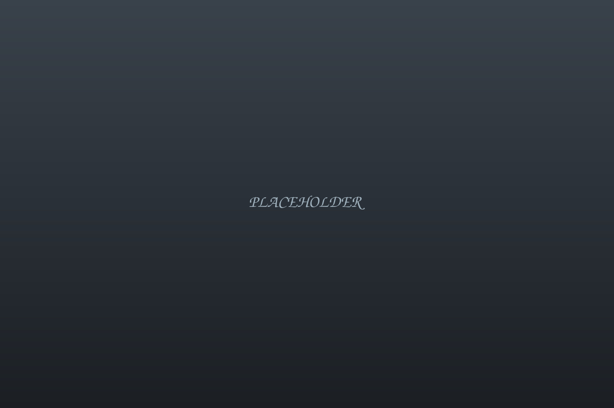

+++
title = "Style guide"
description = "Scratch page that exercises every component in the design system."
draft = true
+++

Scratch page for checking that every component renders correctly in both
themes at 360, 768 and 1280 px. It is a draft, so it is never part of the
published site.

## Project cards

<ul class="card-grid breakout">
  <li class="card">
    <a class="card__link" href="#">
      
      <h3 class="card__title">Real-time smart lighting</h3>
      
One-line description of the project goes here.

      
2017 – 2020ProtoPixelembedded, lighting

    </a>
  </li>
  <li class="card">
    <a class="card__link" href="#">
      
      <h3 class="card__title">AI deployment for automated driving</h3>
      
A second card, to check the two-column grid.

      
Apr 2023 – presentCARIADedge AI, automotive

    </a>
  </li>
</ul>

## Meta row

Apr 2023 – presentCARIADedge AI, automotive, leadership

## Figure

<figure>
  
  <figcaption>A caption in muted small text.</figcaption>
</figure>

## Figure, wide break-out

<figure class="breakout">
  
  <figcaption>The same figure breaking out to the container width.</figcaption>
</figure>

## Gallery

  <figure>
    
    <figcaption>Grid item one.</figcaption>
  </figure>
  <figure>
    
    <figcaption>Grid item two.</figcaption>
  </figure>
  <figure>
    
    <figcaption>Grid item three.</figcaption>
  </figure>

## Callout

<aside class="callout">

Details of this work are confidential; this page describes my role and the public context only.

</aside>

## Timeline

<ol class="timeline">
  <li class="timeline__item">
    
Apr 2023 – present

    

      <h3 class="timeline__role">Head of AI Deployment</h3>
      
CARIAD

      
Leads the AI Deployment team to optimize, integrate and deploy AI models on embedded hardware.

      

        
Drives tooling and automation for scalable, multi-platform deployment.

      

    

  </li>
  <li class="timeline__item">
    
Jan 2017 – Aug 2020

    

      <h3 class="timeline__role">Software Engineer – Real-Time Hardware</h3>
      
ProtoPixel

      
Firmware for real-time smart lighting hardware products.

    

  </li>
</ol>

## Tag list

<ul class="tag-list">
  <li class="tag"><a href="#">embedded</a></li>
  <li class="tag"><a href="#">lighting</a></li>
  <li class="tag"><a href="#">real-time</a></li>
  <li class="tag"><a href="#" aria-current="page">edge-ai</a></li>
</ul>

## Prev / next

<nav class="prev-next" aria-label="Project">
  <a class="prev-next__link" href="#">
    Previous
    Light-emitting wearables
  </a>
  <a class="prev-next__link prev-next__next" href="#">
    Next
    Edge AI for remote patient monitoring
  </a>
</nav>
